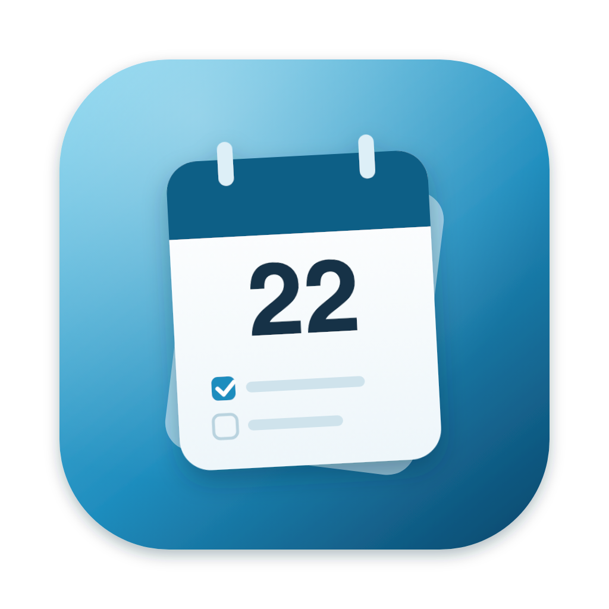
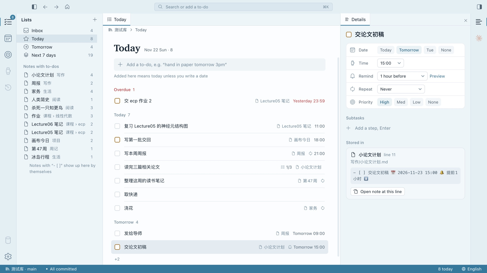
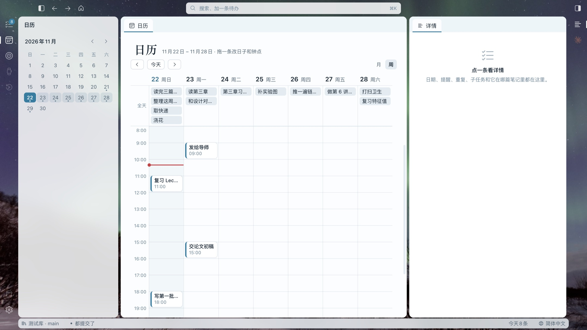
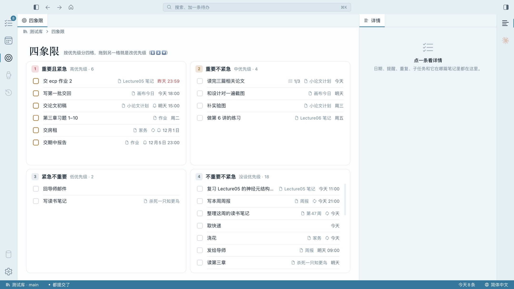
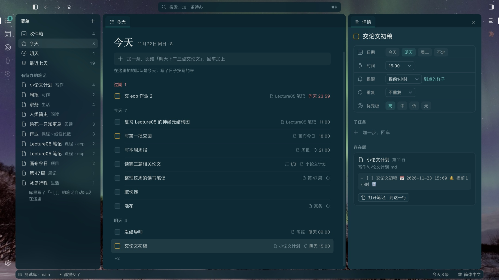
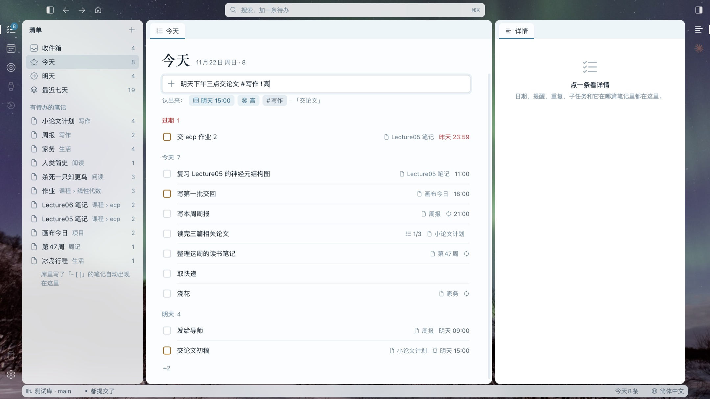

<p align="center"></p>

<h1 align="center">Canvas Today</h1>

<p align="center"><b>Your tasks are the <code>- [ ]</code> lines in your Markdown notes. Today, a calendar, four quadrants, and reminders on your Mac.</b></p>

<p align="center">
<a href="https://github.com/SchaeferAnjon/canvas-today/releases/latest/download/CanvasToday-mac-arm64.dmg"><b>Download for Mac (Apple silicon)</b></a> ·
<a href="https://github.com/SchaeferAnjon/canvas-today/releases/latest/download/CanvasToday-mac-x64.dmg">Mac (Intel)</a> ·
<a href="https://canvas-note.us-cloud.uk/?lang=en#today">Website</a>
</p>

<p align="center">
<a href="https://github.com/SchaeferAnjon/canvas-today/releases/latest"></a>
<a href="LICENSE"></a>

</p>

<p align="center"><sub><a href="README.md">简体中文</a> · <b>English</b></sub></p>

<p align="center"></p>

## What it is

Canvas Today is the task app of [Canvas Notes](https://github.com/SchaeferAnjon/canvas-notes) and uses the same vault. There is no separate database: every task is a line in one of your notes, for example

```markdown
- [ ] 交论文初稿 📅 2026-11-23 15:00 🔔 提前1小时 ⏫
```

To-dos you write in a note show up in Canvas Today right away. When you tick one off, change its date or set a reminder, Canvas Today rewrites only those few characters of that line and leaves every other byte of the note alone. The notes it changed are committed to the vault's Git after a short pause, so you can undo.

What version 0.1.0 does:

- **Lists**: Inbox, Today, Tomorrow, Next 7 days, plus one list for every note in the vault that has to-dos
- **Details**: date, time, reminder, repeat, priority, subtasks, and which line of which note it lives on
- **Calendar**: month and week views; drag a task to another day to change its date, onto an hour to set its time
- **Four quadrants**: tasks sorted by priority and date; drag one to another quadrant to change its priority
- **Quick add**: one sentence such as “tomorrow 3pm submit paper #writing !high” is read into date, time, repeat (every Friday), list and priority, and you see what was understood before it is added
- **Reminders**: Mac notifications you can tick off or snooze for 10 minutes, an hour or until tomorrow; what rang and what was snoozed is recorded in the vault, so another computer knows too
- **Menu bar window**: how many are left today, tick them off, add one
- **⌘K**: search to-dos, add one, jump to a list
- **Chinese and English interface**
- **Open note at this line**: opens the note in Canvas Notes with the cursor on this task (needs a Canvas Notes release after 0.4.9; see below)
- **Updates**: updates itself from the releases on GitHub

The date, reminder and repeat words written into the file are Chinese (`提前1小时`, `每周日`) whichever interface language you use, so the same line reads the same on every device.

## Screenshots

The sample vault is made up (a paper, courses, chores, an Iceland trip), and the clock is set to the morning of 22 November 2026.

<table>
<tr>
<td width="50%" align="center"><br><sub>Calendar: drag to change the day and time</sub></td>
<td width="50%" align="center"><br><sub>Four quadrants, layout A (like VS Code)</sub></td>
</tr>
<tr>
<td align="center"><br><sub>Floating desk layout, dark theme</sub></td>
<td align="center"><br><sub>Quick add says what it understood</sub></td>
</tr>
</table>

## Download

| | Download | Requires |
|---|---|---|
| **Mac with Apple silicon** (M1 and later) | [`CanvasToday-mac-arm64.dmg`](https://github.com/SchaeferAnjon/canvas-today/releases/latest/download/CanvasToday-mac-arm64.dmg) | macOS 12 or later |
| **Mac with an Intel chip** | [`CanvasToday-mac-x64.dmg`](https://github.com/SchaeferAnjon/canvas-today/releases/latest/download/CanvasToday-mac-x64.dmg) | macOS 12 or later |

Not sure which chip? Apple menu → About This Mac. If Chip says Apple M, take the first one; if it says Intel, take the second. Earlier versions and release notes are on the [releases page](https://github.com/SchaeferAnjon/canvas-today/releases); every release has a `SHA256SUMS.txt`.

### Install

Open the dmg and drag Canvas Today into Applications.

### Opening it the first time

This version is signed with an Apple Developer ID but not notarized by Apple (neither are the author's other apps), so macOS says it cannot verify it the first time:

- **macOS 15 (Sequoia) and later**: double-click Canvas Today in Applications and click Done. Then open System Settings › Privacy & Security, scroll to Security, click Open Anyway next to Canvas Today, click Open Anyway again in the dialog and enter your password. After that it opens normally. Right-click › Open no longer gets past the warning on these versions.
- **macOS 14 (Sonoma) and earlier**: right-click Canvas Today in Finder, choose Open, then Open again in the dialog. Once is enough.

Reminders are Mac notifications: the first time one rings, macOS asks whether to allow them. To keep the Done and Snooze buttons on screen until you click one, set the style to Alerts in System Settings › Notifications › Canvas Today.

### Do I need Canvas Notes?

No. Canvas Today works on its own: on first launch pick a folder as your vault (an empty one, or one that already has Markdown files). Tasks you add without naming a note go to `收件箱/待办.md` (Inbox/To-do) in the vault. Git is required; macOS offers to install the command line tools the first time.

With Canvas Notes installed, Canvas Today opens the vault Canvas Notes had open last and follows its theme and layout. Open note at this line needs a Canvas Notes release after 0.4.9: 0.4.9 and earlier do not understand this link yet and only switch to Canvas Notes without opening the note.

### Updates

It checks GitHub for a new version 30 seconds after opening and every 6 hours after that. Once a new version has downloaded in the background, Restart to update to x appears at the right end of the status bar; click it to switch now, or it installs the next time you quit. Settings › About lets you check by hand or turn automatic checks off.

## How a task line is written

Markers are emoji, as in the Obsidian Tasks plugin, in any order:

| Marker | Meaning | Example |
|---|---|---|
| `📅` | Date, optionally with a time | `📅 2026-11-23 15:00` |
| `🔔` | Reminder | `🔔 准时` (on time), `🔔 提前1小时` (1 hour before), `🔔 前一天20:00` (day before at 20:00) |
| `🔁` | Repeat | `🔁 每周日` (every Sunday), `🔁 每月1日` (monthly on the 1st), `🔁 每3天（做完后）` (every 3 days after done) |
| `⏫` `🔼` `🔽` | High, medium, low priority | |
| `✅` | Date it was done | `✅ 2026-11-22` |
| `🆔` | ID (for links like `canvas-today://task/<id>`) | `🆔 a1b2c3` |

A `- [ ]` indented under another one is its subtask. Lines inside code blocks are not tasks.

## Privacy

- No account, no server, no usage statistics. The app opens the folder you pick and only goes online to check GitHub for updates.
- Tasks live in the Markdown files of your vault. Which reminders rang or were snoozed is recorded under `.canvas-tasks/提醒/<device name>/` in the vault; each computer writes only its own file, and it travels with the vault's Git.
- Settings are in `~/Library/Application Support/canvas-today/`.

## Development

```bash
pnpm install
pnpm dev                 # opens a window; CT_VAULT=<folder> picks the vault
pnpm test                # unit tests
pnpm typecheck
pnpm test:e2e            # builds, then drives the real Electron app with Playwright (test mode, no window on screen)
pnpm build               # build to apps/today/out/ only
pnpm dist:mac            # a local .app (ad-hoc signed): apps/today/release/mac-arm64/
```

Layout: `apps/today` is the app (Electron + React + TypeScript, built with electron-vite); `packages/tasks` reads and writes task lines (no Electron, Canvas Notes uses it too); `packages/design` holds the colours, themes and icons shared with Canvas Notes; `packages/git` calls the system git; `packages/format` provides the three-way merge used by undo. `apps/notes/` only holds the few Canvas Notes files Canvas Today borrows (the theme table, the rules for reading Canvas Notes settings, the updater, two window background photos); see the README there.

This repository is exported from the author's private workspace, one commit per release. To release: `pnpm release` (Developer ID signed, not notarized; see the notes at the top of `apps/today/scripts/release.mjs`).

## License

[GPL-3.0-or-later](LICENSE). Copyright © 2026 Jia Zonghan.

Bundled libraries, the window background photos (CC0) and the icons (CC BY 4.0) are listed in [THIRD_PARTY_NOTICES.md](THIRD_PARTY_NOTICES.md).
