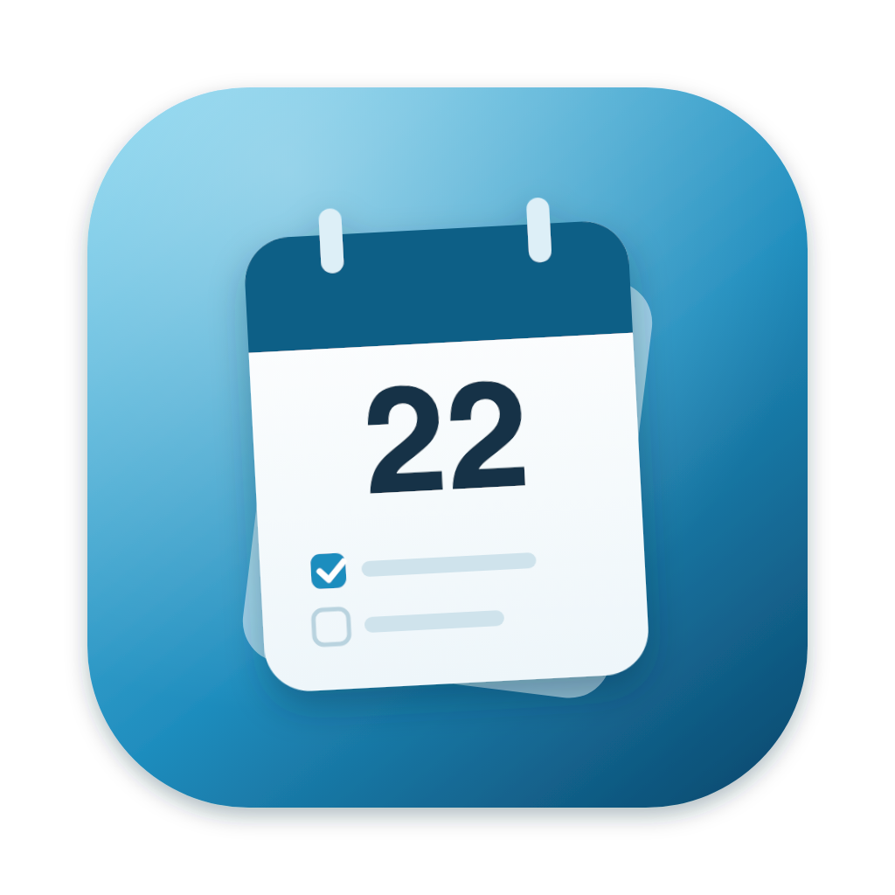
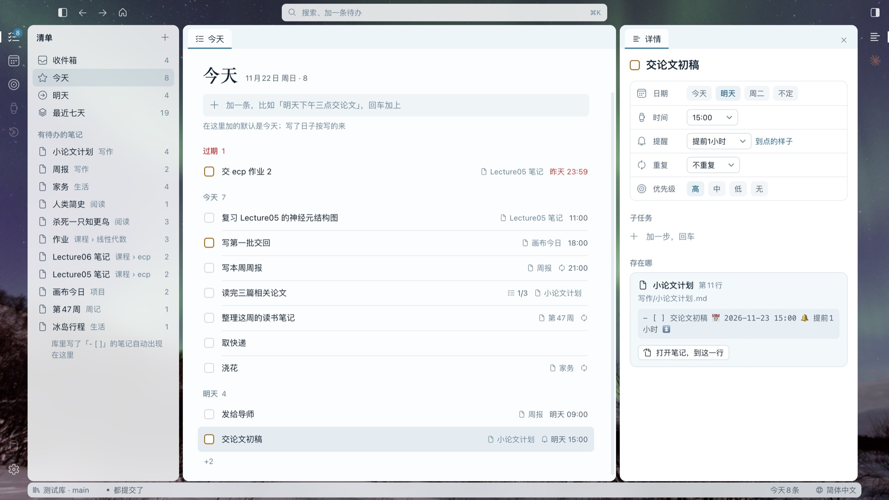
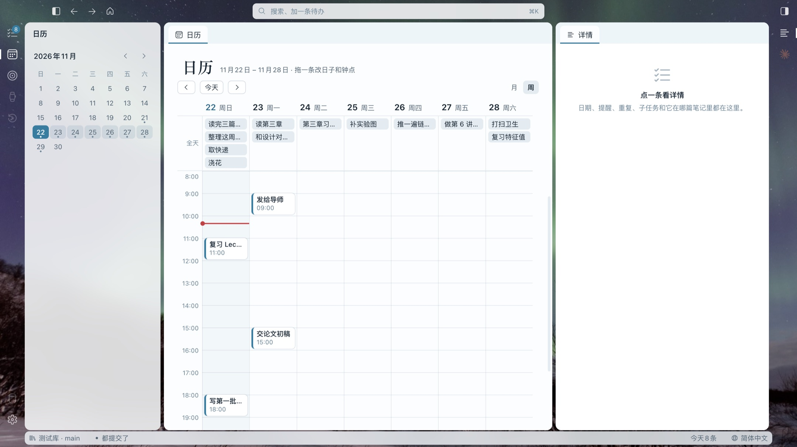
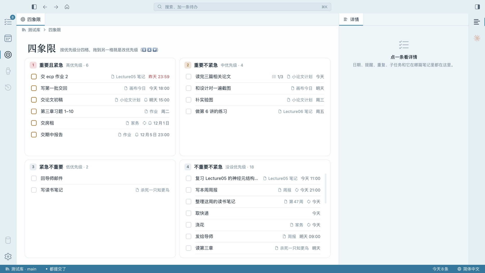
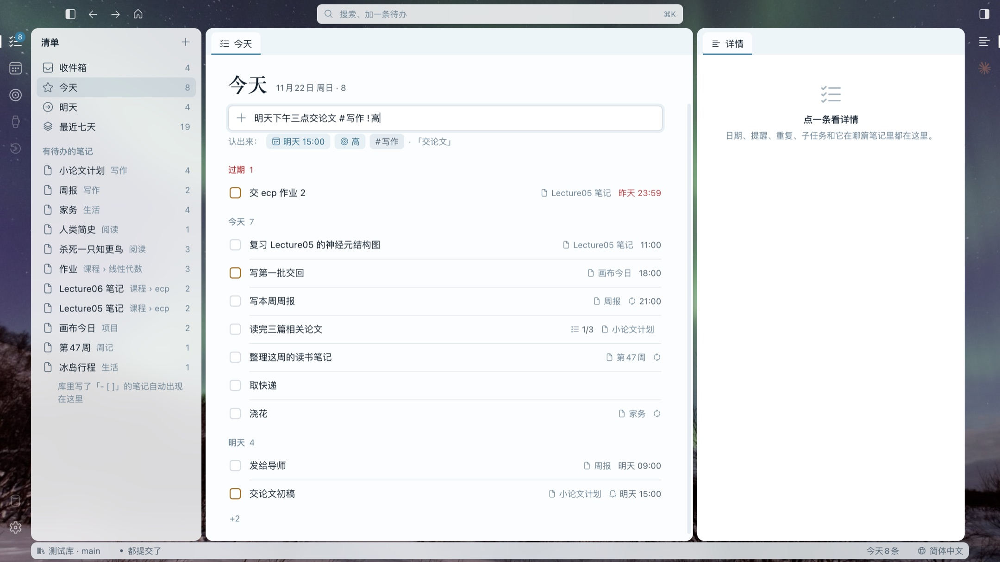
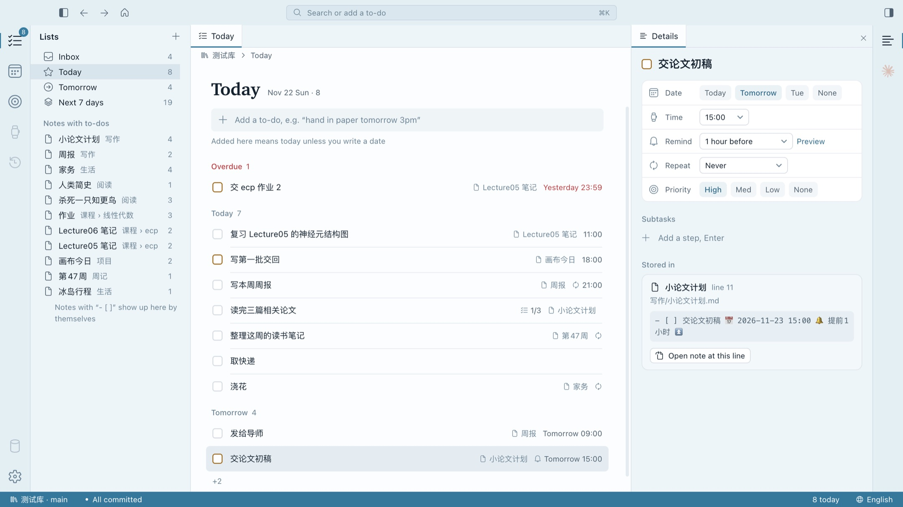
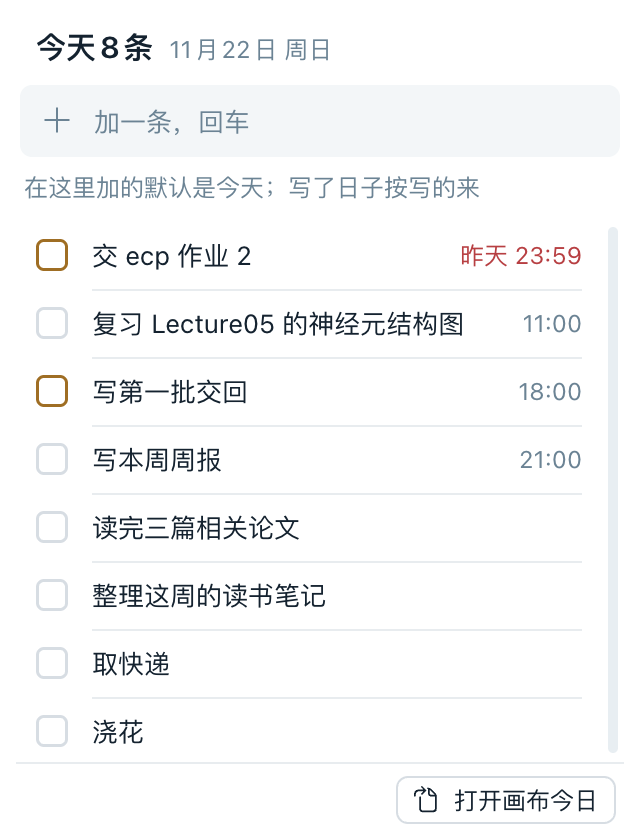

<p align="center"></p>

<h1 align="center">Canvas Today · 画布今日</h1>

<p align="center"><b>任务就是你 Markdown 笔记里的一行 <code>- [ ]</code>。今天做什么、日历、四象限，到点在 Mac 上提醒。</b></p>

<p align="center">
<a href="https://github.com/SchaeferAnjon/canvas-today/releases/latest/download/CanvasToday-mac-arm64.dmg"><b>下载 Mac 版（Apple 芯片）</b></a> ·
<a href="https://github.com/SchaeferAnjon/canvas-today/releases/latest/download/CanvasToday-mac-x64.dmg">Mac 版（Intel）</a> ·
<a href="https://canvas-note.us-cloud.uk/#today">官网</a>
</p>

<p align="center">
<a href="https://github.com/SchaeferAnjon/canvas-today/releases/latest"></a>
<a href="LICENSE"></a>

</p>

<p align="center"><sub><b>简体中文</b> · <a href="README.en.md">English</a></sub></p>

<p align="center"><picture><source media="(prefers-color-scheme: dark)" srcset="docs/shots/today-b-dark.jpg"></picture></p>

## 是什么

画布今日是 [Canvas Notes（画布笔记）](https://github.com/SchaeferAnjon/canvas-notes) 的任务软件，和它用同一个库。它不另建数据库：每条任务就是库里某篇笔记的一行，比如

```markdown
- [ ] 交论文初稿 📅 2026-11-23 15:00 🔔 提前1小时 ⏫
```

在笔记里写的待办，画布今日马上列出来；在画布今日里勾掉、改日子、设提醒，只改那一行里的那几个字，同一篇笔记别的字节一个不动。自己改过的几篇停手一会儿自动提交到库的 Git，能撤回。

这一版（0.3.0）能做的：

- **清单**：收件箱、今天、明天、最近七天，还有库里所有写了待办的笔记，各自一个清单
- **详情**：日期、钟点、提醒、重复、优先级、子任务，和它在哪篇笔记的第几行
- **日历**：月、周两种看法；把一条拖到别的日子改日期，拖到钟点上改时间
- **四象限**：按优先级和日子分四格，拖到另一格就是改优先级
- **快速加**：一句话「明天下午三点交论文 #写作 !高」认出日子、钟点、重复（每周五）、清单和优先级，加之前先告诉你认出了什么
- **到点提醒**：Mac 的通知，能直接勾掉、推迟 10 分钟、1 小时或到明天；响过和推迟记进库里，换台电脑也知道
- **提醒事项**：带提醒的待办放进 iCloud 提醒事项的「画布今日」列表，iPhone、iPad 上到点也响；在提醒事项里勾掉、改时间、改标题写回笔记里那一行，放进去了的这台 Mac 不再另响一次。还能把提醒事项里原有的列表一次导进库
- **习惯打卡**：每个习惯是库里「习惯」文件夹的一篇笔记，看最近七天和连续几天，今天点一下打卡（打卡就是那篇末尾加一行），漏了的前几天也能补
- **专注**：番茄钟 25 分钟，挂在一条任务上；专注满了记进库里，任务详情里看得到专注过几个番茄
- **系统日历（只读）**：日历里显示 Mac「日历」App 的日程，拖不动、不改它，排时间时避开
- **AI 拆小步、排进空着的时间**：选一条任务，让 AI 拆成几步子任务；在日历里让 AI 把今天、明天没定钟点的排进空着的时间。先给你看，收下才写进笔记，能撤销。用的是画布笔记设置里选的那一家 AI（这台 Mac 上装好、登录过的命令行，比如 Claude Code）
- **菜单栏小窗**：今天还有几条、勾掉、快速加一条
- **⌘K**：搜待办、加一条、去哪个清单
- **中英文界面**
- **打开笔记，到这一行**：在画布笔记里打开这一篇，光标停在这条任务上（要画布笔记 0.5.0 或更新，见下面「要不要先装画布笔记」）
- **检查更新**：从 GitHub 上的正式版自动更新

## 截图

样本库是编的（论文、课程、家务、冰岛行程），钟拨到 2026 年 11 月 22 日上午。

<table>
<tr>
<td width="50%" align="center"><br><sub>日历，拖一条改日子和钟点</sub></td>
<td width="50%" align="center"><br><sub>四象限，A 风格（照 VS Code）</sub></td>
</tr>
<tr>
<td align="center"><br><sub>快速加，先说认出了什么</sub></td>
<td align="center"><br><sub>English</sub></td>
</tr>
</table>

<p align="center"><br><sub>菜单栏小窗</sub></p>

## 下载

| | 下载 | 要求 |
|---|---|---|
| **Apple 芯片的 Mac**（M1 及以后） | [`CanvasToday-mac-arm64.dmg`](https://github.com/SchaeferAnjon/canvas-today/releases/latest/download/CanvasToday-mac-arm64.dmg) | macOS 12 或更新 |
| **Intel 芯片的 Mac** | [`CanvasToday-mac-x64.dmg`](https://github.com/SchaeferAnjon/canvas-today/releases/latest/download/CanvasToday-mac-x64.dmg) | macOS 12 或更新 |

不知道是哪种芯片：点屏幕左上角的苹果菜单，选「关于本机」，「芯片」那一行写 Apple M 就选上面那个，写 Intel 就选下面。以前的版本和每一版改了什么在[发布页](https://github.com/SchaeferAnjon/canvas-today/releases)，每一版都附了 `SHA256SUMS.txt`。

### 装

打开下载的 dmg，把 Canvas Today 拖进「应用程序」。

### 第一次打开怎么放行

这一版用 Apple 开发者证书（Developer ID）签了名，但没有经过 Apple 公证（作者的其他软件也没有），所以第一次打开时 macOS 会说无法验证它：

- **macOS 15（Sequoia）及以后**：先在「应用程序」里双击 Canvas Today，提示框里点「完成」；再打开 系统设置 › 隐私与安全性，翻到「安全性」那一段，点 Canvas Today 旁边的「仍要打开」，在弹出的框里再点一次「仍要打开」并输入登录密码。之后就能正常打开。右键「打开」在这些版本上已经绕不过这个提示。
- **macOS 14（Sonoma）及更早**：在访达里右键点 Canvas Today，选「打开」，提示框里再点「打开」。只要这一次。

到点提醒用的是 Mac 的通知：第一次响之前 macOS 会问要不要允许，点允许；想让「勾掉」「推迟」按钮一直留在屏幕上，到 系统设置 › 通知 › Canvas Today 把样式改成「提醒」。

想让手机上也响：设置 › 日历和提醒事项 里点「连接提醒事项」，第一次 macOS 会问一次能不能让画布今日访问提醒事项，点「好」。要先在 系统设置 › 你的名字 › iCloud 里打开「提醒事项」；不连也能用，这台 Mac 自己响。

想在日历里看到系统日历的日程：日历左栏点「连接系统日历」（或者 设置 › 日历和提醒事项 打开「显示系统日历的日程」），第一次 macOS 会问一次能不能访问日历，点「允许完全访问」。画布今日只读日程，不改。

### 要不要先装画布笔记

不用。画布今日自己就能用：第一次打开选一个文件夹当库（空文件夹，或者已经放着 md 的文件夹都行），快速加的、没写进哪篇笔记的任务放在库里的 `收件箱/待办.md`。需要 Git，第一次用时 macOS 会提示安装命令行工具。

装了画布笔记的话，画布今日自动打开画布笔记上次开的那个库，主题和界面风格也跟着它。「打开笔记，到这一行」要画布笔记 0.5.0 或更新：0.4.9 及更早还不认这种链接，点了只会切到画布笔记，不会打开那一篇。

### 更新

打开 30 秒后查一次 GitHub 上有没有新版本，之后每 6 小时一次；新版在后台下好后，窗口底栏最右端出「重启更新到 x」，点一下就换上，不点也行，下次退出时自动装上。设置 › 关于 里能手动查、关掉自动检查。

## 任务那一行怎么写

和 Obsidian Tasks 插件一样用表情符号做记号，读的时候顺序随意：

| 记号 | 意思 | 例子 |
|---|---|---|
| `📅` | 日期，可以带钟点 | `📅 2026-11-23 15:00` |
| `🔔` | 提醒 | `🔔 准时`、`🔔 提前1小时`、`🔔 前一天20:00` |
| `🔁` | 重复 | `🔁 每周日`、`🔁 每月1日`、`🔁 每3天（做完后）` |
| `⏫` `🔼` `🔽` | 高、中、低优先级 | |
| `✅` | 哪天勾掉的 | `✅ 2026-11-22` |
| `🆔` | 编号（链接 `canvas-today://task/<编号>` 用） | `🆔 a1b2c3` |

缩进在一条下面的 `- [ ]` 是它的子任务。代码块里的不算任务。

习惯是 `习惯/` 文件夹里的一篇篇笔记（文件名就是习惯的名字），打卡就是末尾一行：

```markdown
---
重复: 每周一、三、五
开始: 2026-11-16
---
# 跑步

- 2026-11-16 ✓
- 2026-11-18 ✓
```

「重复」和 🔁 一个写法（每天、工作日、每周几、每N天……），不写就是每天。

## 隐私

- 没有账号，没有服务器，没有使用统计。软件只打开你选的那个文件夹，只在检查更新时连 GitHub。
- 任务、习惯在你库里的 md 文件里；提醒响过、推迟的记录在库里的 `.canvas-tasks/提醒/<设备名>/` 下，专注记录在 `.canvas-tasks/专注/<设备名>/` 下，每台电脑只写自己那份，跟着库的 Git 走。
- 系统日历只读，不往里写。AI 拆小步、排时间时，交给这台 Mac 上那一家 AI 命令行的是这一条任务、它前后几行，或者今天明天没定钟点的待办和占着的时间段，不发别的。
- 设置在 `~/Library/Application Support/canvas-today/`。

## 开发

```bash
pnpm install
pnpm dev                 # 打开窗口；CT_VAULT=<文件夹> 直接指定库
pnpm test                # 单元测试
pnpm typecheck
pnpm test:e2e            # 构建后用 Playwright 驱动真的 Electron（测试模式，窗口不上屏）
pnpm build               # 只构建到 apps/today/out/
pnpm dist:mac            # 本机用的 .app（本地签名）：apps/today/release/mac-arm64/
```

结构：`apps/today` 是软件（Electron + React + TypeScript，electron-vite 构建）；`packages/tasks` 读写任务那一行（不依赖 Electron，画布笔记也用它）；`packages/design` 是和画布笔记共用的颜色、主题和图标；`packages/git` 调系统 git；`packages/format` 是撤销时用的三方合并。`apps/notes/` 里只有画布今日借用的几个画布笔记文件（主题表、读画布笔记设置的规则、检查更新、两张窗口背景照片），见那里的 README。

这个仓库是从作者的私有工作区导出的，每一版一个提交。发版：`pnpm release`（Developer ID 签名、不公证，见 `apps/today/scripts/release.mjs` 开头的说明）。

## 许可证

[GPL-3.0-or-later](LICENSE)。Copyright © 2026 Jia Zonghan。

随包分发的库、窗口背景照片（CC0）、图标（CC BY 4.0）见 [THIRD_PARTY_NOTICES.md](THIRD_PARTY_NOTICES.md)。
